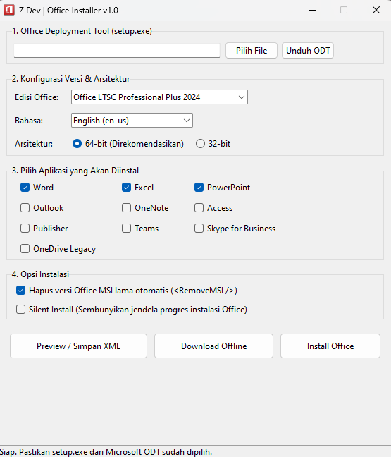

<div align="center">
  
  <h1 align="center">Office Deployment GUI</h1>
  <p align="center">
    Aplikasi antarmuka grafis (GUI) ringan untuk mengunduh dan menginstal Microsoft Office secara resmi melalui <strong>Office Deployment Tool (ODT)</strong> tanpa perlu mengedit file XML secara manual.
  </p>

  <p align="center">
    <a href="https://github.com/ZzDevl/Office-Deployment-GUI/releases">
      
    </a>
    
    
    <a href="LICENSE">
      
    </a>
  </p>
</div>

---

## Pratinjau Aplikasi

<div align="center">
  
</div>

## Fitur Utama

- **100% Resmi Microsoft CDN:** Memanfaatkan `setup.exe` dari Office Deployment Tool (ODT) untuk menarik paket instalasi langsung dari server resmi Microsoft.
- **Kustomisasi Aplikasi Spesifik:** Pilih hanya aplikasi yang dibutuhkan (Word, Excel, PowerPoint, Outlook, Access, Visio, Project, dll.) tanpa memenuhi ruang penyimpanan.
- **Dukungan Multi-Edisi:** Mendukung Office LTSC 2024 (Pro Plus & Standard), Project 2024, Visio 2024, serta Microsoft 365 Apps.
- **Mode Online & Offline:** Instal langsung secara *streaming* atau unduh paket installer offline untuk digunakan di perangkat lain tanpa koneksi internet.
- **Pembersihan Otomatis:** Opsi `<RemoveMSI />` untuk menghapus versi Office lawas berbasis MSI sebelum instalasi dimulai.
- **Generator XML Dinamis:** Menyusun dan menampilkan pratinjau `configuration.xml` secara otomatis sesuai pilihan di GUI.

---

## Cara Penggunaan (Pengguna Umum)

1. Unduh **`OfficeInstaller.exe`** versi terbaru pada halaman [**Releases**](https://github.com/ZzDevl/Office-Deployment-GUI/releases).
2. Unduh **Office Deployment Tool (ODT)** resmi dari [Microsoft Download Center](https://www.microsoft.com/en-us/download/details.aspx?id=49117).
3. Jalankan installer ODT untuk mengekstrak file **`setup.exe`**, lalu tempatkan `setup.exe` di folder yang sama dengan `OfficeInstaller.exe`.
4. Buka **`OfficeInstaller.exe`** (otomatis meminta izin Administrator UAC).
5. Pilih edisi Office, bahasa, arsitektur (`64-bit` / `32-bit`), serta centang aplikasi yang diinginkan.
6. Klik **Install Office** untuk instalasi langsung, atau **Download Offline** untuk menyimpan file instalasi ke penyimpanan lokal.

---

## Cara Build dari Source Code (Developer)

Pastikan **Python 3.10+** sudah terinstal dan terdaftar di *Environment Variables (PATH)* Windows.

**1. Clone repository ini:**
```bash
git clone [https://github.com/ZzDevl/Office-Deployment-GUI.git](https://github.com/ZzDevl/Office-Deployment-GUI.git)
```

**2. Masuk ke direktori proyek:**
```bash
cd Office-Deployment-GUI
```

**3. Install PyInstaller:**
```powershell
pip install pyinstaller
```

**4. Compile menjadi file `.exe` mandiri (Auto-Admin):**
```powershell
pyinstaller --onefile --noconsole --uac-admin --icon="assets/icon.ico" --name "OfficeInstaller" office_installer.py
```

Setelah proses selesai, file **`OfficeInstaller.exe`** akan tersedia di dalam folder `dist/`.

---

## Contoh Output `configuration.xml`

Aplikasi ini otomatis menghasilkan konfigurasi standar ODT seperti berikut sebelum mengeksekusi `setup.exe`:

```xml
<?xml version="1.0" ?>
<Configuration>
  <Add Channel="PerpetualVL2024" OfficeClientEdition="64">
    <Product ID="ProPlus2024Volume">
      <Language ID="en-us"/>
      <ExcludeApp ID="Outlook"/>
      <ExcludeApp ID="OneNote"/>
      <ExcludeApp ID="Access"/>
      <ExcludeApp ID="Publisher"/>
      <ExcludeApp ID="Teams"/>
      <ExcludeApp ID="Lync"/>
      <ExcludeApp ID="Groove"/>
    </Product>
  </Add>
  <RemoveMSI/>
  <Display AcceptEULA="TRUE" Level="Full"/>
</Configuration>
```

---

## Disclaimer

Proyek ini merupakan *frontend wrapper* untuk mempermudah pembuatan file `configuration.xml` bagi **Microsoft Office Deployment Tool (ODT)**. Aplikasi ini **tidak** menyertakan *crack*, *activator*, atau metode bypass lisensi dalam bentuk apa pun. Pengguna tetap memerlukan lisensi resmi (Product Key / akun Microsoft 365 berlisensi) setelah masa evaluasi berakhir.
